<!-- Generated by scripts/generate-assets.py. Edit profile.json and the generator. -->

<a href="https://brunosouza.dev.br">
<picture>
  <source media="(max-width: 600px)" srcset="assets/hero-mobile.svg">
  
</picture>
</a>

[Portfólio](https://brunosouza.dev.br) · [LinkedIn](https://www.linkedin.com/in/bruno-soares-souza/) · [E-mail](mailto:brunosouzagithub2003@gmail.com)

<picture>
  <source media="(max-width: 600px)" srcset="assets/about-mobile.svg">
  
</picture>

Sou desenvolvedor Full Stack e gosto de transformar ideias em experiências digitais. Trabalho com desenvolvimento web, sistemas, interfaces interativas e soluções que unem código, design e movimento.

**Rio de Janeiro, Brasil** · Ciência da Computação — UNIFESO

<picture>
  <source media="(max-width: 600px)" srcset="assets/skills-mobile.svg">
  
</picture>

<picture>
  <source media="(max-width: 600px)" srcset="assets/missions-mobile.svg">
  
</picture>

<a href="https://brunosouza.dev.br">
<picture>
  <source media="(max-width: 600px)" srcset="assets/missions/01-mobile.svg">
  
</picture>
</a>

<a href="https://genesisempreendimentos.com.br">
<picture>
  <source media="(max-width: 600px)" srcset="assets/missions/02-mobile.svg">
  
</picture>
</a>

<a href="https://limeag.com.br">
<picture>
  <source media="(max-width: 600px)" srcset="assets/missions/03-mobile.svg">
  
</picture>
</a>

<a href="https://genesio.genesisapps.com.br">
<picture>
  <source media="(max-width: 600px)" srcset="assets/missions/04-mobile.svg">
  
</picture>
</a>

<a href="https://karinasarte.com.br">
<picture>
  <source media="(max-width: 600px)" srcset="assets/missions/05-mobile.svg">
  
</picture>
</a>

<a href="https://github.com/Brun05ouza/captaflow">
<picture>
  <source media="(max-width: 600px)" srcset="assets/missions/06-mobile.svg">
  
</picture>
</a>

<picture>
  <source media="(max-width: 600px)" srcset="assets/log-mobile.svg">
  
</picture>

<picture>
  <source media="(max-width: 600px)" srcset="assets/github-stats-mobile.svg">
  
</picture>

[Explorar meus repositórios](https://github.com/Brun05ouza?tab=repositories) · [Como as estatísticas são calculadas](docs/maintenance.md#estatísticas)

<picture>
  <source media="(max-width: 600px)" srcset="assets/contact-mobile.svg">
  
</picture>

[Portfólio](https://brunosouza.dev.br) · [GitHub](https://github.com/Brun05ouza) · [LinkedIn](https://www.linkedin.com/in/bruno-soares-souza/) · [E-mail](mailto:brunosouzagithub2003@gmail.com)
